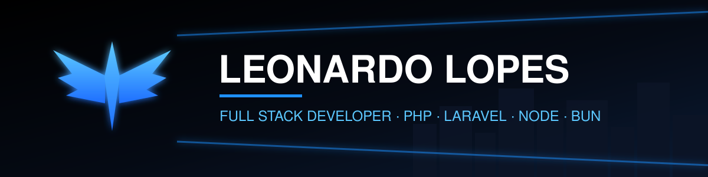

 

---

## `> whoami`

Full Stack Developer at **Grupo GPS**, based in Rio Grande do Sul, Brazil. I build and maintain web systems end to end, with a focus on PHP/Laravel and TypeScript backends running on Node.js and Bun.

## `> stack`

## `> my sites`

- **[Division Dev](https://divisiondev.com.br)**: my startup
- **[Division Flow](https://divisionflow.com)**: my product
- **[devleonardo.com](https://devleonardo.com)** (portfolio)

## `> featured`

| Project | Stack | What it is |
| :-- | :-- | :-- |
| [**nexo-assist**](https://github.com/devleonardolopes/nexo-assist) | TypeScript | Assistant project built with TypeScript |
| [**rdb2026-bun**](https://github.com/devleonardolopes/devleonardolopes-rdb2026-bun) | TypeScript · Bun | My entry for Rinha de Backend 2026 |
| [**crm-division**](https://github.com/devleonardolopes/crm-division) | Laravel · Blade | CRM web application |

## `> stats`

---

*"The night is darkest just before the dawn."*

