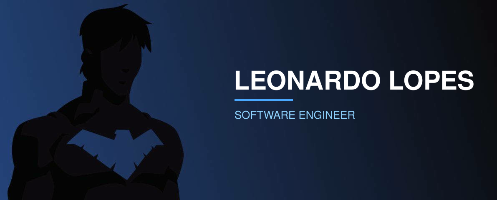
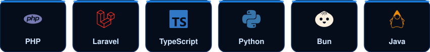

Software Engineer at **Grupo GPS** and founder of **Division Dev**, based in Rio Grande do Sul, Brazil. I build and maintain web systems end to end, working mainly with PHP/Laravel, TypeScript and Python.

| Project | Stack | What it is |
| :-- | :-- | :-- |
| [**nexo-assist**](https://github.com/devleonardolopes/nexo-assist) | TypeScript | Assistant built with TypeScript |
| [**rdb2026-bun**](https://github.com/devleonardolopes/devleonardolopes-rdb2026-bun) | TypeScript, Bun | My entry for Rinha de Backend 2026 |
| [**crm-division**](https://github.com/devleonardolopes/crm-division) | Laravel, Blade | CRM web application |

*"The night is darkest just before the dawn."*

